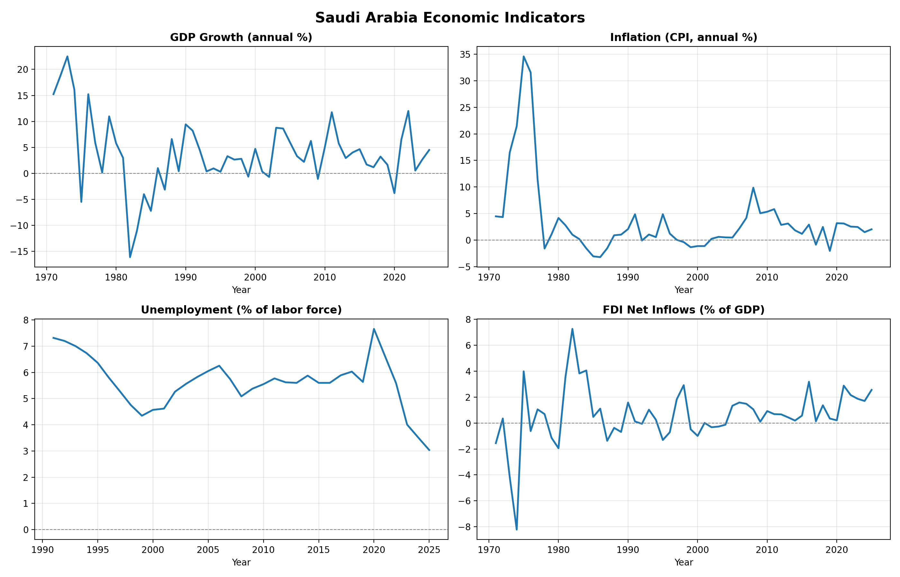

# Saudi Arabia Economic Indicators Analysis

Analysis of Saudi Arabia's key economic indicators using Python (pandas, matplotlib) and World Bank data.

## Indicators
| Indicator | World Bank Code |
|---|---|
| GDP growth (annual %) | NY.GDP.MKTP.KD.ZG |
| Inflation, CPI (annual %) | FP.CPI.TOTL.ZG |
| Unemployment (% of labor force) | SL.UEM.TOTL.ZS |
| FDI net inflows (% of GDP) | BX.KLT.DINV.WD.GD.ZS |

## Dashboard

## Key Observations
- Inflation spiked above 30% in the mid-1970s during the oil boom, then stabilized below 5% for most of the following decades.
- GDP growth is highly volatile and follows oil price cycles, with a sharp decline in the early 1980s and a dip in 2020.
- Unemployment data starts in 1990 and declines sharply after its peak around 2019-2020.
- FDI inflows were volatile in the 1970s-80s and more stable afterwards.

## Method
1. Downloaded Excel files from the World Bank Open Data portal.
2. Cleaned and reshaped the data (wide to long) with pandas.
3. Merged the four indicators by year and plotted them with matplotlib.

## Tools
Python, pandas, matplotlib, Google Colab

## Data Source
[World Bank Open Data](https://data.worldbank.org) (World Development Indicators)
